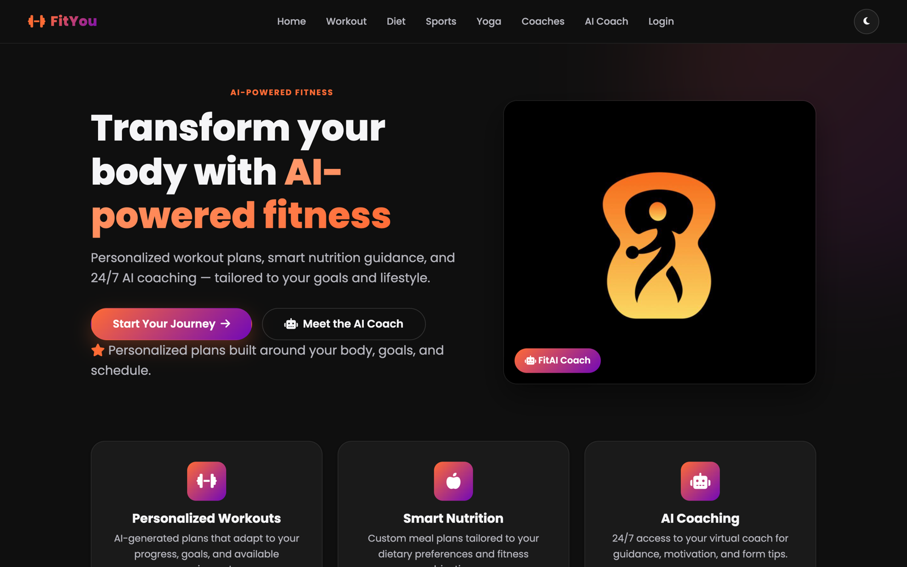
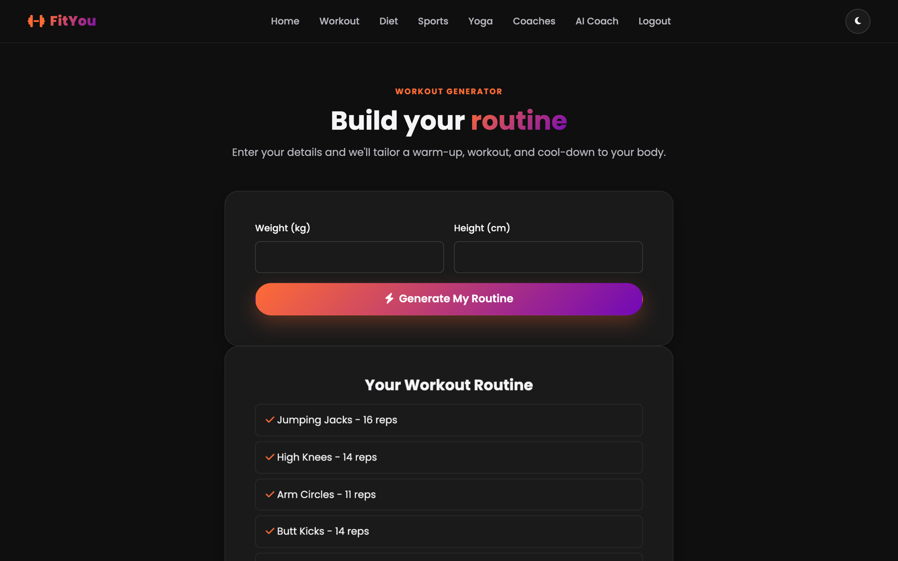
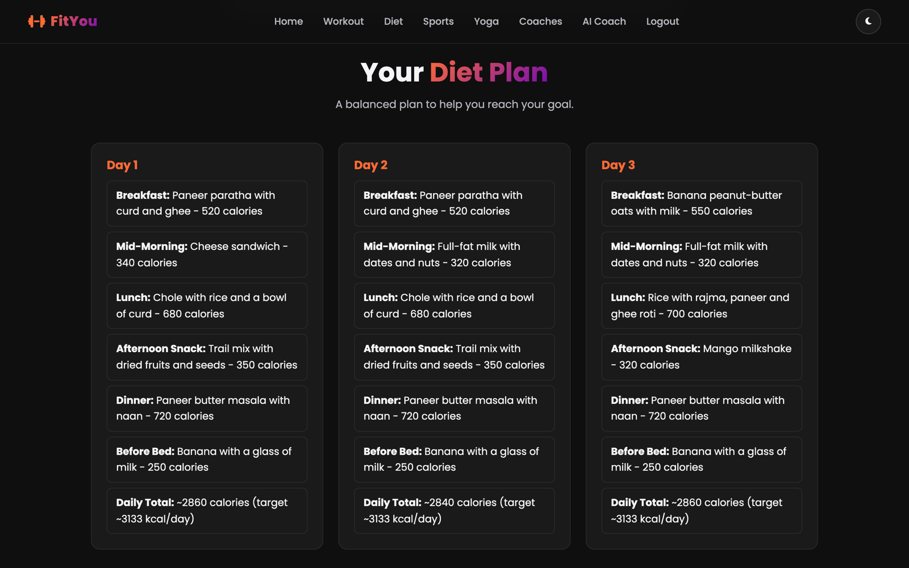
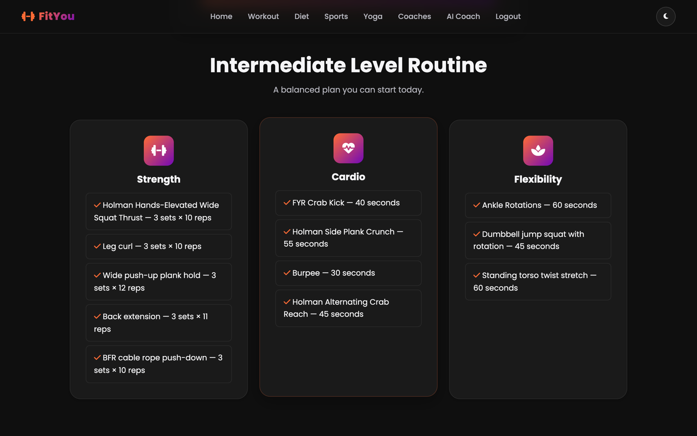
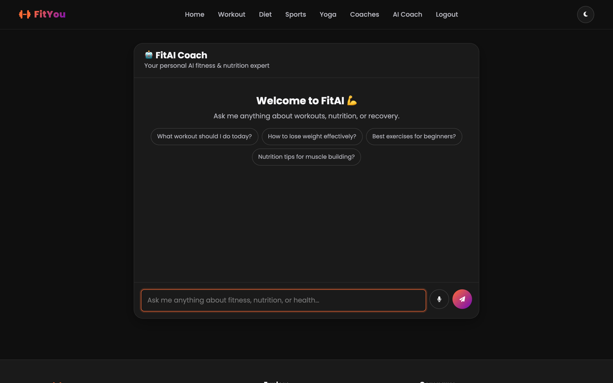
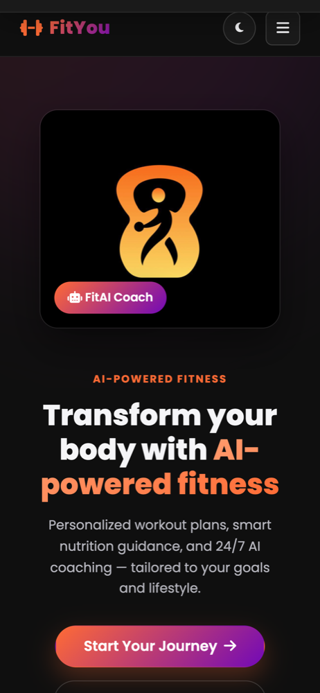
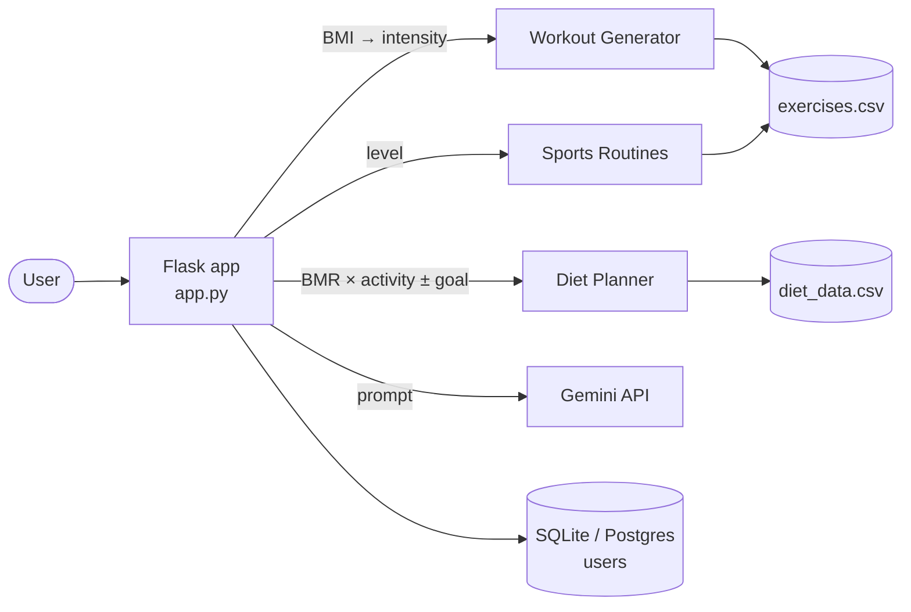

<div align="center">


# FitYou

**An open-source, AI-powered fitness companion.**
Personalized workouts, Indian-cuisine meal plans, and a Gemini-powered coach, all in one Flask app.

[](https://fit-you-six.vercel.app/)
[](runtime.txt)
[](requirements.txt)
[](https://ai.google.dev/)
[](LICENSE)
[](CONTRIBUTING.md)
[](https://github.com/Nikhil210206/FitYou/stargazers)

[**Live Demo**](https://fit-you-six.vercel.app/) · [**Report a Bug**](https://github.com/Nikhil210206/FitYou/issues/new?template=bug_report.yml) · [**Request a Feature**](https://github.com/Nikhil210206/FitYou/issues/new?template=feature_request.yml)

<br />

<picture>
  <source media="(prefers-color-scheme: light)" srcset="docs/screenshots/home-light.png" />
  
</picture>

</div>

---

## Table of Contents

- [About](#about)
- [Features](#features)
- [Screenshots](#screenshots)
- [Tech Stack](#tech-stack)
- [How It Works](#how-it-works)
- [Getting Started](#getting-started)
- [Configuration](#configuration)
- [Project Structure](#project-structure)
- [Deployment](#deployment)
- [Roadmap](#roadmap)
- [Contributing](#contributing)
- [License](#license)
- [Acknowledgments](#acknowledgments)

## About

Most fitness apps are paywalled, generic, or built around Western diets. FitYou is a free, open-source alternative that:

- builds **workout routines** from your body metrics and fitness level,
- creates **multi-day meal plans** from a curated dataset of Indian dishes, sized to your calorie target, and
- answers fitness and nutrition questions through an **AI coach** backed by Google Gemini.

It is a single, lightweight Flask app with no frontend build step, so it is easy to run locally, read, and contribute to.

## Features

| | Feature | What it does |
|---|---|---|
| 🏋️ | **Workout Generator** | Calculates your BMI from height and weight, maps it to a training intensity, and builds a warm-up → workout → cool-down routine from 180+ exercises. |
| 🥗 | **Diet Planner** | Estimates your BMR (Mifflin-St Jeor) and TDEE from age, gender and activity level, adjusts for your goal (lose / maintain / gain), and generates a 1–30 day vegetarian or non-vegetarian plan with six meals a day. |
| 🩺 | **Health-aware meals** | Adds dietary guidance when you select diabetes, high blood pressure, heart disease or high cholesterol. |
| 🏃 | **Sports Routines** | Beginner, intermediate and advanced routines split into strength, cardio and flexibility blocks, with sets and reps that scale by level. |
| 🤖 | **FitAI Coach** | A chat assistant powered by Gemini 2.5 Flash, scoped to fitness, nutrition and recovery, with voice input and automatic model fallback. |
| 📅 | **7-Day Plan & Yoga** | A guided weekly workout plan with day-by-day pages, plus a yoga section. |
| 🧑‍🏫 | **Coaches Directory** | Browse trainers by specialty and city. |
| 🔐 | **Accounts** | Sign up and log in with hashed passwords, CSRF-protected forms and secure session cookies. Plan generation and the AI coach need an account. |
| 🌗 | **Light & dark themes** | Responsive design with a theme toggle that is remembered across visits. |

## Screenshots

<table>
  <tr>
    <td width="50%"><br /><sub><b>Workout Generator:</b> BMI-based warm-up, workout and cool-down</sub></td>
    <td width="50%"><br /><sub><b>Diet Planner:</b> multi-day Indian meal plans with calorie targets</sub></td>
  </tr>
  <tr>
    <td width="50%"><br /><sub><b>Sports Routines:</b> strength, cardio and flexibility by level</sub></td>
    <td width="50%"><br /><sub><b>FitAI Coach:</b> Gemini-powered fitness chat</sub></td>
  </tr>
</table>

<div align="center">
  
  <br /><sub>Fully responsive on mobile</sub>
</div>

## Tech Stack

| Layer | Technology |
|---|---|
| Backend | [Flask 3](https://flask.palletsprojects.com/), [Gunicorn](https://gunicorn.org/) |
| Frontend | Jinja2 templates, vanilla CSS design system, vanilla JavaScript |
| AI | [Google Gemini](https://ai.google.dev/) via `google-generativeai` (`gemini-2.5-flash` by default) |
| Data | [pandas](https://pandas.pydata.org/) over CSV datasets (`exercises.csv`, `diet_data.csv`) |
| Auth & DB | Flask-Login, Flask-WTF (CSRF), Flask-SQLAlchemy, SQLite (local) / PostgreSQL (production) |
| Hosting | [Vercel](https://vercel.com/) or [Render](https://render.com/) |

## How It Works



- **Workouts:** BMI under 18.5 → intensity 50, 18.5–24.9 → 70, 25–29.9 → 60, 30+ → 40. Intensity sets how many exercises are drawn from each phase (20% warm-up, 60% workout, 20% cool-down).
- **Diet:** `BMR = 10·weight + 6.25·height − 5·age (+5 male / −161 female)`, multiplied by an activity factor (1.2–1.9) to get TDEE, then ±500 kcal for weight gain or loss.
- **AI Coach:** every message is wrapped in a fitness-only system prompt. If the configured Gemini model fails or is retired, the app falls back through a list of current models.

## Getting Started

### Prerequisites

- Python 3.12+
- A free [Google Gemini API key](https://aistudio.google.com/app/apikey) (only needed for the AI coach)

### Installation

```bash
git clone https://github.com/Nikhil210206/FitYou.git
cd FitYou
```

```bash
python -m venv .venv
source .venv/bin/activate   # Windows: .venv\Scripts\activate
```

```bash
pip install -r requirements.txt
```

```bash
cp env_template.txt .env
```

Open `.env` and set `GEMINI_API_KEY` and `SECRET_KEY` (see [Configuration](#configuration)). Then start the app:

```bash
flask --app app run --debug
```

Open **http://localhost:5000**. A local SQLite database (`fityou.db`) is created automatically on first run.

## Configuration

All settings are read from environment variables (or a `.env` file).

| Variable | Required | Description |
|---|---|---|
| `GEMINI_API_KEY` | For the AI coach | Your Google Gemini API key. |
| `SECRET_KEY` | Yes | Long random string used to sign sessions. The app refuses to start in production without it; locally it falls back to a temporary random key. Generate one with `python -c "import secrets; print(secrets.token_hex(32))"`. |
| `DATABASE_URL` | In production | PostgreSQL connection string. Defaults to a local SQLite file when unset. |
| `GEMINI_MODEL` | No | Override the default model (`gemini-2.5-flash`). Retired models are ignored automatically. |

## Project Structure

```
FitYou/
├── app.py                 # Flask app: routes, auth, workout/diet/sports logic, Gemini client
├── exercises.csv          # Exercise library (warm-up, workout, cool-down; rep and duration ranges)
├── diet_data.csv          # Indian meal dataset (calories, macros, goal, veg/non-veg)
├── requirements.txt       # Python dependencies
├── env_template.txt       # Example environment variables
├── vercel.json            # Vercel config
├── render.yaml            # Render config
├── templates/             # Jinja2 pages
│   ├── base.html          # Shared layout
│   ├── partials/          # Navbar and footer
│   ├── Home.html          # Landing page
│   ├── index.html         # Workout generator
│   ├── diet.html          # Diet planner
│   ├── sports.html        # Level-based routines
│   ├── chatbot.html       # FitAI coach
│   ├── workout_plan.html  # 7-day plan (+ day1–day7.html)
│   └── ...                # Yoga, coaches, auth, legal and error pages
├── static/
│   ├── css/main.css       # Design system (tokens, components, light/dark themes)
│   ├── js/theme.js        # Theme toggle and mobile nav
│   └── images/
├── docs/screenshots/      # Images used in this README
└── .github/               # Issue/PR templates and workflows
```

## Deployment

FitYou deploys as a standard Python web app.

- **Vercel:** import the repo; `vercel.json` routes all traffic to `app.py`. Vercel's filesystem is read-only, so set `DATABASE_URL` to a hosted Postgres database (for example [Neon](https://neon.tech)).
- **Render:** connect the repo; `render.yaml` runs `gunicorn app:app` and generates a `SECRET_KEY` for you.

See [DEPLOYMENT.md](DEPLOYMENT.md) for details.

## Roadmap

- [ ] Save generated plans to the user's profile and track progress over time
- [ ] Wearable integrations (Google Fit, Apple Health) for activity data
- [ ] Upload medical reports (PDF, DOCX) to detect health conditions automatically
- [ ] Macro breakdown and charts on diet plans
- [ ] Multi-language support
- [ ] Automated test suite and CI checks

Have an idea? [Open a feature request](https://github.com/Nikhil210206/FitYou/issues/new?template=feature_request.yml).

## Contributing

Contributions of every size are welcome: bug fixes, new exercises or recipes in the datasets, UI improvements, docs, and tests.

1. Fork the repo and create a branch: `git checkout -b feat/your-feature`
2. Make your changes and test them locally
3. Commit with a clear message: `git commit -m "feat: add macro chart to diet plan"`
4. Push and open a pull request

Read [CONTRIBUTING.md](CONTRIBUTING.md) for the full workflow, and check the [open issues](https://github.com/Nikhil210206/FitYou/issues) for places to start. To report a security issue, see [SECURITY.md](SECURITY.md).

### Contributors

Thanks to everyone who has contributed to FitYou.

<a href="https://github.com/Nikhil210206/FitYou/graphs/contributors">
  
</a>

## License

FitYou is released under the [MIT License](LICENSE).

> **Disclaimer:** FitYou gives general fitness and nutrition guidance. It is not medical advice. Talk to a qualified professional before starting a new diet or training program, especially if you have a health condition.

## Acknowledgments

- [Google Gemini](https://ai.google.dev/) for the AI coach
- [Font Awesome](https://fontawesome.com/) for icons and [Unsplash](https://unsplash.com/) for imagery
- Everyone who contributed during Open Source Connect India 2025

---

<div align="center">

Built by [Nikhil Balamurugan](https://github.com/Nikhil210206). If FitYou helps you, please consider giving it a ⭐

</div>
